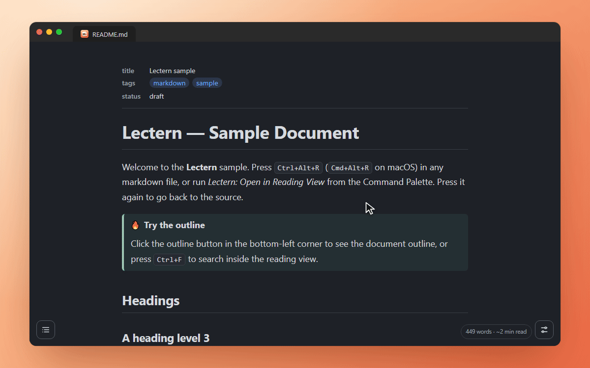
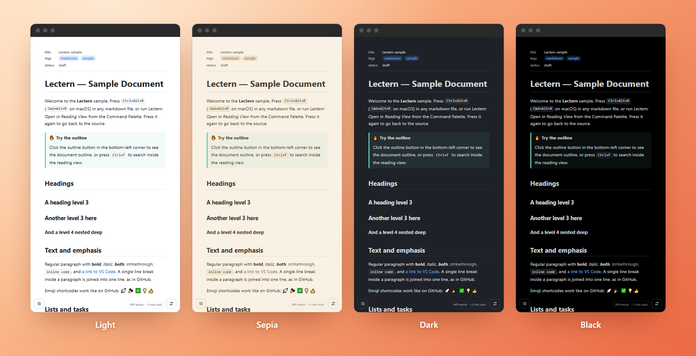
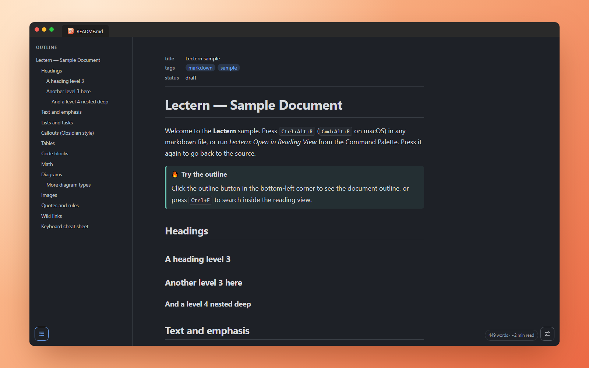
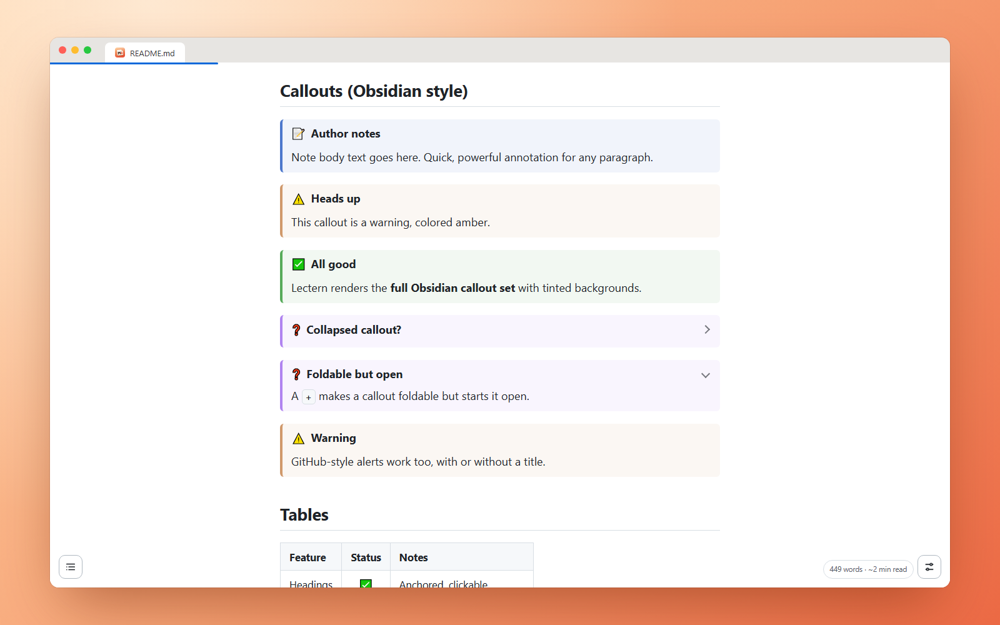
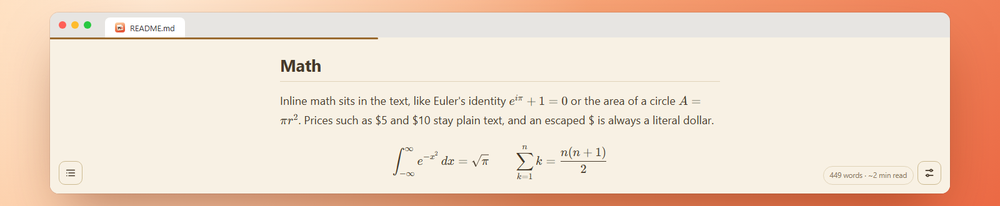
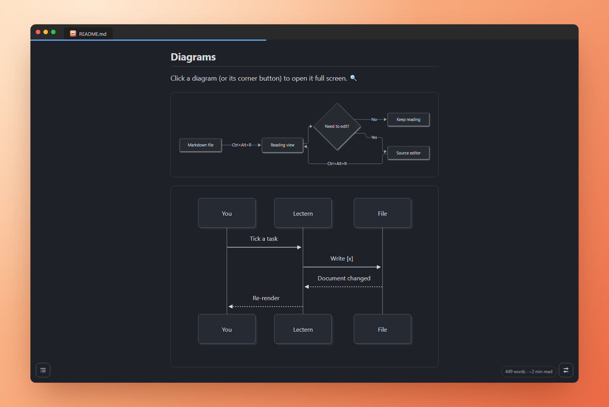
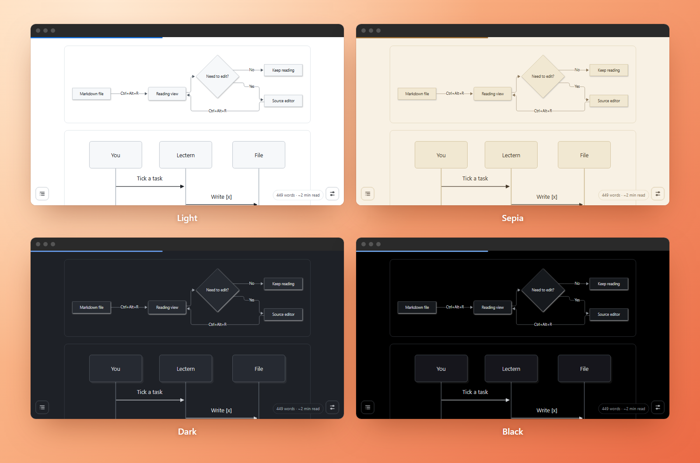
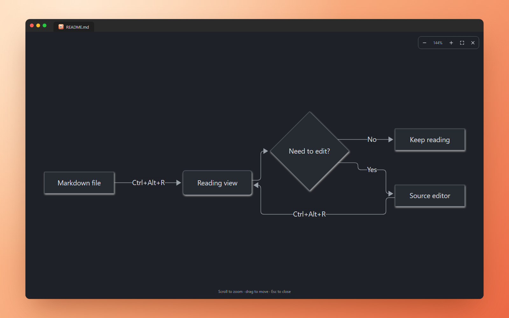
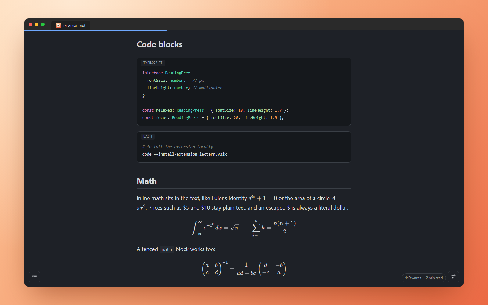
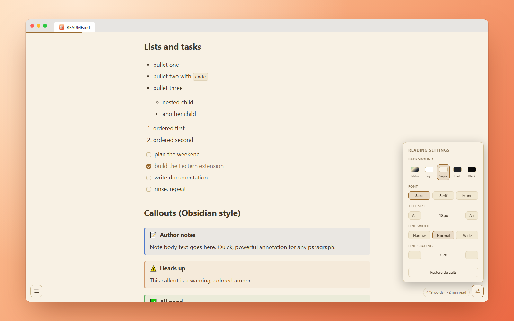

<p align="center">
  
</p>

<h1 align="center">Lectern</h1>

<p align="center">
  <strong>A calm, beautiful reading view for Markdown in VS Code.</strong><br>
  Open any note, doc or README as a page you actually want to read.
</p>

<p align="center">
  <a href="https://marketplace.visualstudio.com/items?itemName=OmarElmasry.lectern"></a>
  <a href="https://open-vsx.org/extension/OmarElmasry/lectern"></a>
  <a href="https://open-vsx.org/extension/OmarElmasry/lectern"></a>
  <a href="https://github.com/Omar-Elmassry/lectern/actions/workflows/ci.yml"></a>
  <a href="LICENSE"></a>
</p>

<p align="center">
  <a href="#getting-started">Getting started</a> ·
  <a href="#features">Features</a> ·
  <a href="#settings">Settings</a> ·
  <a href="CHANGELOG.md">Changelog</a> ·
  <a href="https://github.com/Omar-Elmassry/lectern/releases">Releases</a>
</p>

<p align="center">
  
</p>

VS Code's built-in preview is made for checking Markdown while you write it. **Lectern is
made for reading it.** Your file opens in the same tab as a clean, comfortable page with
good typography, a warm palette if you want one, and nothing else on screen. Ticking a task
or following a link works right there, and the source is one keystroke away.

## Getting started

1. Install **Lectern** from the Extensions view (search for "Lectern").
2. Open any `.md`, `.markdown` or `.mdx` file.
3. Press **`Ctrl+Alt+R`** (**`Cmd+Alt+R`** on macOS). Press it again to go back to the source.

Lectern needs VS Code 1.82 or newer. It also works in editors built on VS Code, such as
Cursor, Windsurf, Antigravity and VSCodium; it's on [Open VSX](https://open-vsx.org/extension/OmarElmasry/lectern)
for the ones that install from there.

You can also click the **book icon** in the editor title bar, right-click a file in the
Explorer and choose **Open in Reading View**, or run **Lectern: Open in Reading View** from
the Command Palette.

> **Tip: want Markdown to always open in Lectern?** Right-click a Markdown tab, choose
> **Reopen Editor With… → Configure default editor for '\*.md'… → Reading View - Lectern: Markdown Reader**.
> Or add this to your `settings.json`:
>
> ```json
> "workbench.editorAssociations": { "*.md": "lectern.reader" }
> ```

## Features

### A palette for every light

Read in **Light**, **Sepia**, **Dark** or **Black**, or let **Editor** follow your VS Code
theme. High Contrast themes are supported too.

<p align="center">
  
</p>

### Always know where you are

A slide-out **outline** tracks the section you're reading and jumps anywhere in one click.
A thin **progress bar** and a **word count with reading time** sit quietly at the edges.

<p align="center">
  
</p>

### Callouts, tasks and wiki links

- **Callouts** in Obsidian style (`> [!note]`, `> [!warning]`, …), including **foldable**
  ones (`[!faq]-`), plus GitHub alerts (`> [!IMPORTANT]`).
- **Task lists you can tick.** Clicking a checkbox updates `[ ]` / `[x]` in the file itself.
- **Wiki links**: `[[Note]]`, `[[Note#Heading]]`, `[[Note|label]]` and embeds such as
  `![[diagram.png|300]]` or videos, resolved across your workspace. Missing notes get a
  dashed underline.
- **Links stay in the reader.** A link to `other.md#setup` opens that file in Lectern at
  that heading; web links open in your browser.

<p align="center">
  
</p>

### Math

Write formulas the way GitHub and Obsidian do: `$…$` inline, `$$…$$` on their own lines,
or a ```` ```math ```` block. They're typeset by KaTeX, right in the flow of your text.
Prices like "$5 and $10" stay plain text, and `\$` is always a literal dollar.

<p align="center">
  
</p>

### Diagrams

Mermaid flowcharts, sequence, class, state, ER, Gantt, pie, mind map, timeline and git
diagrams draw straight from a ```` ```mermaid ```` block, in the colours of your reading
palette.

<p align="center">
  
</p>

Switch palettes and every diagram is redrawn to match:

<p align="center">
  
</p>

**Click any diagram to open it full screen.** Zoom with the mouse wheel, the toolbar or
`+` / `-`, drag to move around, press `0` to fit it to the window and `Esc` to close. Big
flowcharts become easy to follow.

<p align="center">
  
</p>

Mermaid only loads when a note contains a diagram, so everything else stays fast, and a
typo shows Mermaid's error next to your source instead of a blank box. The
[math and diagrams guide](docs/math-and-diagrams.md) has the full syntax, the dollar-sign
rules and examples.

### Code that's easy to read

Syntax highlighting for 35+ common languages, with a **language label** and a
one-click **copy button** on each block.

<p align="center">
  
</p>

### Make it yours

The panel in the bottom-right corner sets the **palette**, **font** (sans, serif or mono),
**text size**, **line width** and **line spacing**. Changes apply instantly and carry over
to every file.

<p align="center">
  
</p>

### And the little things

- **Emoji shortcodes** like `:rocket:` 🚀, `:tada:` 🎉 and `:white_check_mark:` ✅ work as
  on GitHub, using GitHub's own list.
- **Front matter** is shown as a tidy list of properties, with tags as chips.
- **Click any image** to view it full window.
- **`Ctrl+F` / `Cmd+F`** searches inside the reading view.
- **Live updates**: edit the source in a split editor and the page follows as you type.
- **Keyboard and screen-reader friendly**: visible focus, labelled controls, `Escape`
  closes panels, and motion is reduced when your OS asks for it.
- **Safe by design**: scripts in your Markdown never run, links can't trigger VS Code
  commands, and diagrams and formulas can't add links or scripts either.

## Settings

Everything is adjustable from the in-view panel. The same values are regular VS Code
settings, so you can also set them per workspace:

| Setting | Default | Description |
| --- | --- | --- |
| `lectern.backgroundMode` | `editor` | `editor`, `light`, `sepia`, `dark` or `black`. |
| `lectern.fontFamily` | `""` | Any CSS font stack. Empty uses the default sans-serif stack. |
| `lectern.fontSize` | `18` | Text size in px (12–28). |
| `lectern.readingWidth` | `760` | Maximum width of the text column in px (480–1600). |
| `lectern.lineHeight` | `1.7` | Line spacing (1.2–2.4). |

## Commands

| Command | Shortcut |
| --- | --- |
| Lectern: Open in Reading View | `Ctrl+Alt+R` / `Cmd+Alt+R` in a Markdown editor |
| Lectern: Open Markdown Source | `Ctrl+Alt+R` / `Cmd+Alt+R` in the reading view |
| Lectern: Open Settings | — |

## Contributing

Bug reports, ideas and pull requests are all welcome. [CONTRIBUTING.md](CONTRIBUTING.md)
explains how to build, test and run Lectern locally; `npm run screenshots` regenerates
every image on this page.

## License

[MIT](LICENSE) © Omar Elmasry. Lectern bundles open-source libraries such as marked,
highlight.js, KaTeX and Mermaid; their licenses are in
[THIRD_PARTY_NOTICES.md](THIRD_PARTY_NOTICES.md).
