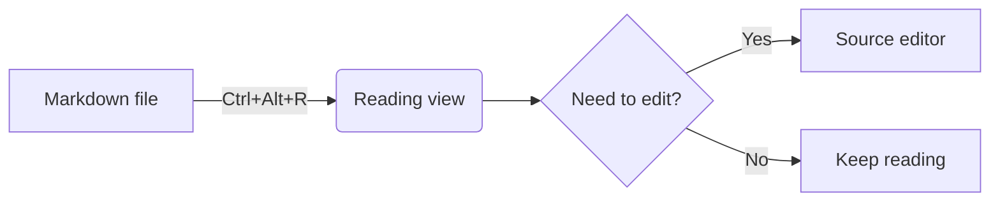

# Math and diagrams

Lectern renders **math** with [KaTeX](https://katex.org/) and **diagrams** with
[Mermaid](https://mermaid.js.org/). You write them the same way as on GitHub and in
Obsidian, so the same file looks right everywhere.


## Math

### Inline math

Wrap TeX in single dollar signs. It sits in the line like any other text.

```markdown
Euler's identity $e^{i\pi} + 1 = 0$ links five constants.
The area of a circle is $A = \pi r^2$.
```

### Display math

Put `$$` on its own lines for a centred block. A ```` ```math ```` code block does the
same, and is what GitHub recommends when a formula has to survive other Markdown tools.

````markdown
$$
\int_{-\infty}^{\infty} e^{-x^2}\,dx = \sqrt{\pi}
$$

```math
\sum_{k=1}^{n} k = \frac{n(n+1)}{2}
```
````

A one-line `$$a^2 + b^2 = c^2$$` inside a paragraph is also shown in display style.

### Dollar signs that aren't math

Lectern uses GitHub's rules, so ordinary prose keeps its dollar signs:

| You write | You get |
| --- | --- |
| `It costs $5 and $10.` | It costs $5 and $10. (plain text: a digit follows the closing `$`) |
| `Between $ 1 and 2 $` | plain text: the content starts or ends with a space |
| `\$x\$` | `$x$` as literal text: a backslash escapes a dollar |
| `` `$x$` `` | code: math is never parsed inside code spans or code blocks |

The rule of thumb: math starts with `$` directly followed by a non-space character and
ends with a non-space character directly followed by `$` (and not by a digit).

### What's supported

Everything KaTeX supports: fractions, roots, sums and integrals, matrices
(`\begin{pmatrix}…\end{pmatrix}`), aligned equations (`\begin{aligned}…\end{aligned}`),
Greek letters, accents, `\text{…}`, colours and more. See the
[KaTeX function list](https://katex.org/docs/supported.html).

Math works inside tables, list items, callouts and headings. Formulas aren't counted in
the word count.

### Errors

A formula KaTeX can't parse is shown as its source, in red with a wavy underline. Hover
over it to see what's wrong, for example `Expected '}', got 'EOF' at end of input`. The
rest of the page renders normally.

### Safety

Commands that could add links or HTML (`\href`, `\url`, `\htmlId`, `\includegraphics`, …)
are disabled, so a formula can never point somewhere unexpected.

## Diagrams

Use a ```` ```mermaid ```` code block. Lectern draws it in your reading palette.

````markdown

````


### Diagram types

All of Mermaid's diagram types work, including:

| Type | Starts with |
| --- | --- |
| Flowchart | `flowchart LR` / `graph TD` |
| Sequence | `sequenceDiagram` |
| Class | `classDiagram` |
| State | `stateDiagram-v2` |
| Entity relationship | `erDiagram` |
| Gantt | `gantt` |
| Pie | `pie` |
| Mind map | `mindmap` |
| Timeline | `timeline` |
| Git graph | `gitGraph` |
| User journey, quadrant, XY chart, Sankey, block, … | see the [Mermaid docs](https://mermaid.js.org/intro/) |

### Colours follow your palette

Diagrams use the colours of the current reading palette and are redrawn when you switch
palettes or VS Code themes, so there's no Mermaid theme to set. (A `theme` in a
`%%{init: …}%%` line is ignored for the same reason.)


### Full-screen viewer

Click a diagram, or the expand button in its top-right corner, to open it full screen in
the current palette. It starts scaled to fit the window.


| To | Mouse | Keyboard |
| --- | --- | --- |
| Zoom in / out | Mouse wheel (zooms towards the pointer), double-click, or the `+` / `-` buttons | `+` / `-` |
| Move around | Drag | Arrow keys |
| Fit to the window | The fit button | `0` |
| Close | The close button | `Esc` |

The expand button can be reached with `Tab` and opened with `Enter`, and focus returns to
it when the viewer closes.

### Size

Wide diagrams shrink to fit the reading column, as on GitHub. Open them in the full-screen
viewer to read them at any size, or try `flowchart TD` (top-down) instead of `LR`, or
**Wide** under **Line width** in the settings panel.

### Errors

If a diagram has a syntax error, Lectern shows Mermaid's message and your source in
place of the diagram, for example:

> **Diagram error:** Parse error on line 3: Expecting 'AMP', 'COLON', … got 'EOF'

Other diagrams on the page still draw.

### Performance

Mermaid is large (about 5 MB), so Lectern only loads it when a note actually contains a
diagram; other notes don't pay for it. The first diagram in a session can take a moment
to appear. After that, diagrams are cached, so editing the source in a split editor
doesn't make them flicker or move the page.

### Safety

Diagrams run in Mermaid's `strict` security mode: scripts and click handlers in
diagram source are ignored, and labels are treated as text.
