# Lectern — Sample Document

Welcome to the **Lectern** sample. Press `Ctrl+Alt+R` (`Cmd+Alt+R` on macOS) in any
markdown file, or run *Lectern: Open in Reading View* from the Command Palette.
Press it again to go back to the source.

> [!tip] Try the outline
> Click the outline button in the bottom-left corner to see the document outline,
> or press `Ctrl+F` to search inside the reading view.

## Headings

### A heading level 3

### Another level 3 here

#### And a level 4 nested deep

## Text and emphasis

Regular paragraph with **bold**, *italic*, ***both***, ~~strikethrough~~,
`inline code`, and [a link to VS Code](https://code.visualstudio.com).
A single line break inside a paragraph is joined into one line, as in GitHub.

Emoji shortcodes work like on GitHub: :rocket: :tada: :white_check_mark: :bulb: :+1:

## Lists and tasks

- bullet one
- bullet two with `code`
- bullet three
  - nested child
  - another child

1. ordered first
2. ordered second

- [ ] plan the weekend
- [x] build the Lectern extension
- [ ] write documentation
- [ ] rinse, repeat

## Callouts (Obsidian style)

> [!note] Author notes
> Note body text goes here. Quick, powerful annotation for any paragraph.

> [!warning] Heads up
> This callout is a warning, colored amber.

> [!success] All good
> Lectern renders the **full Obsidian callout set** with tinted backgrounds.

> [!question]- Collapsed callout?
> Callouts with a `-` start collapsed; click the title to expand.

> [!faq]+ Foldable but open
> A `+` makes a callout foldable but starts it open.

> [!WARNING]
> GitHub-style alerts work too, with or without a title.

## Tables

| Feature      | Status | Notes                      |
| ------------ | :----: | -------------------------- |
| Headings     |   ✅   | Anchored, clickable        |
| Task lists   |   ✅   | Clickable → edits the file |
| Callouts     |   ✅   | Obsidian-style             |
| Wiki links   |   ✅   | Linked to `notes/Journal`  |
| Math         |   ✅   | KaTeX, inline and display  |
| Diagrams     |   ✅   | Mermaid, themed to match   |

## Code blocks

```ts
interface ReadingPrefs {
  fontSize: number;   // px
  lineHeight: number; // multiplier
}

const relaxed: ReadingPrefs = { fontSize: 18, lineHeight: 1.7 };
const focus: ReadingPrefs = { fontSize: 20, lineHeight: 1.9 };
```

```bash
# install the extension locally
code --install-extension lectern.vsix
```

## Math

Inline math sits in the text, like Euler's identity $e^{i\pi} + 1 = 0$ or the
area of a circle $A = \pi r^2$. Prices such as $5 and $10 stay plain text, and
an escaped \$ is always a literal dollar.

$$
\int_{-\infty}^{\infty} e^{-x^2}\,dx = \sqrt{\pi}
\qquad
\sum_{k=1}^{n} k = \frac{n(n+1)}{2}
$$

A fenced `math` block works too:

```math
\begin{pmatrix} a & b \\ c & d \end{pmatrix}^{-1}
= \frac{1}{ad - bc} \begin{pmatrix} d & -b \\ -c & a \end{pmatrix}
```

## Diagrams

Click a diagram (or its corner button) to open it full screen. :mag:

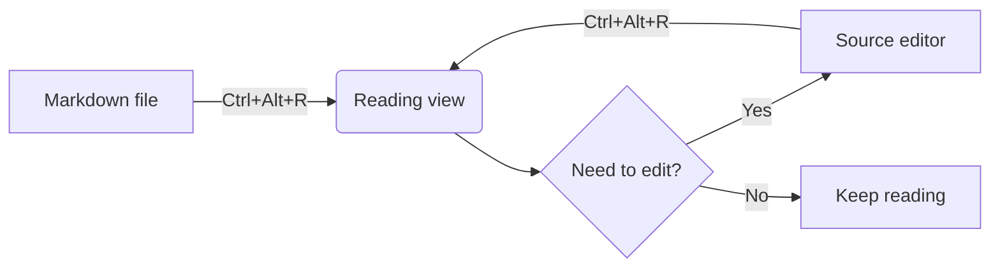

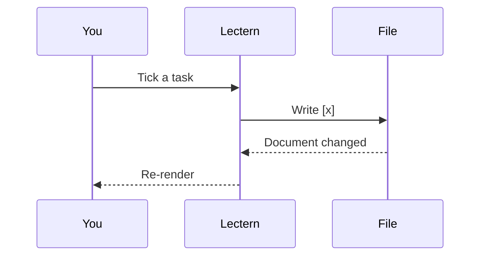

### More diagram types

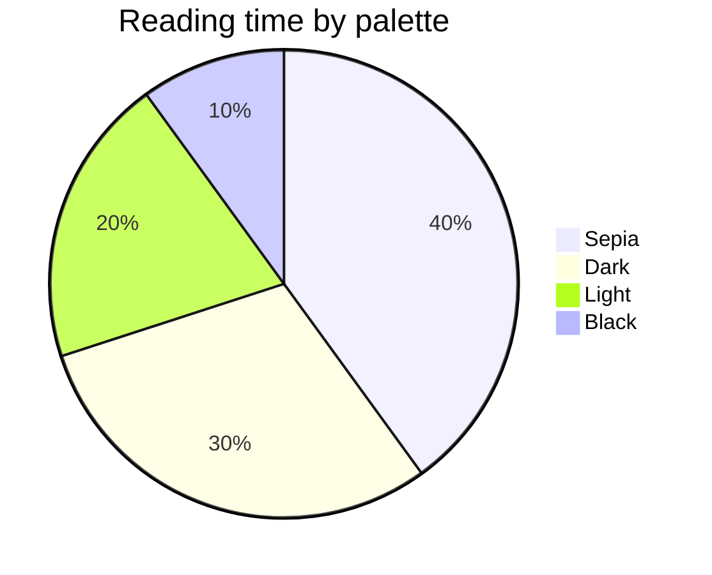

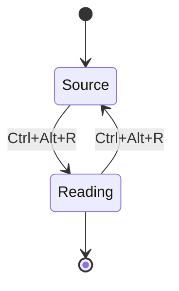

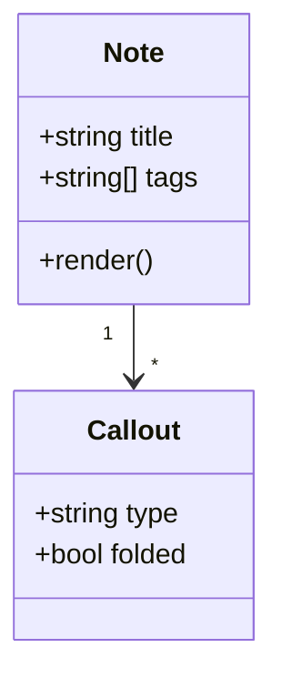

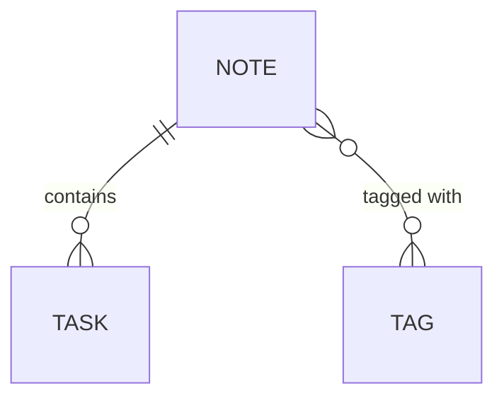

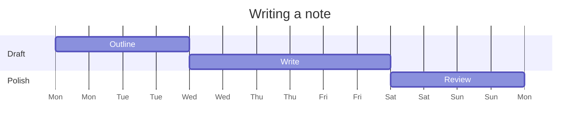

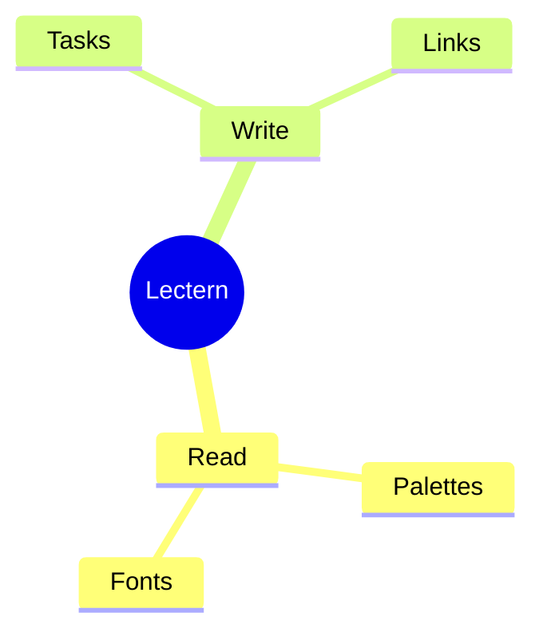

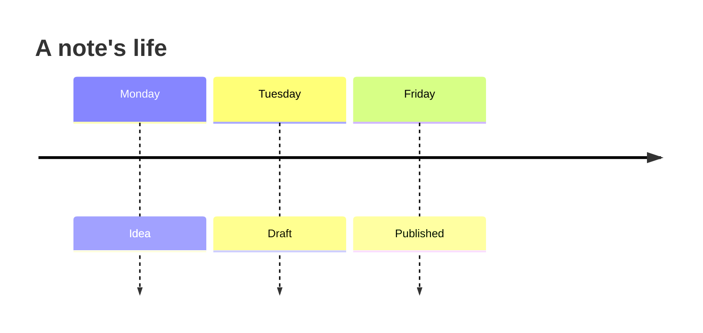

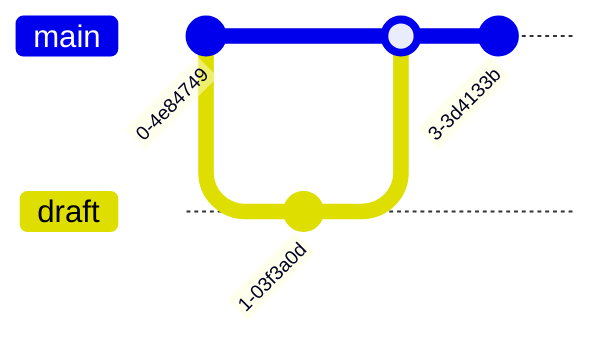

## Images

Click the image to zoom; press Escape or click again to close.

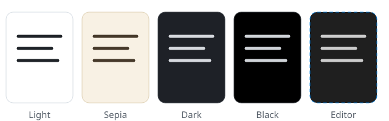

Obsidian-style embeds work as well, with an optional width:

![[reading-modes.svg|320]]

## Quotes and rules

> Simple blockquote without a callout marker.

---

## Wiki links

Go to [Journal entry](notes/Journal.md) by relative path, or straight to a heading with
[its TODO list](notes/Journal.md#todo). Wiki links work too: [[Journal]],
[[Journal#TODO]], [[Journal|a custom label]], or a heading in this note like
[[#Math]]. Unresolved links like [[Ghost Note]] render with a dashed underline.

## Keyboard cheat sheet

| Shortcut              | Action                                  |
| --------------------- | --------------------------------------- |
| `Ctrl+Alt+R`          | Toggle reading view / source            |
| `Ctrl+F`              | Search inside reading view              |
| Outline button        | Show or hide the outline                |
| Click a checkbox      | Toggle the task in source               |
| Click an image        | View it full window                     |
| Click a diagram       | Full screen; wheel or `+`/`-` to zoom, `0` to fit |
| `Esc`                 | Close the viewer, image or open panel   |
