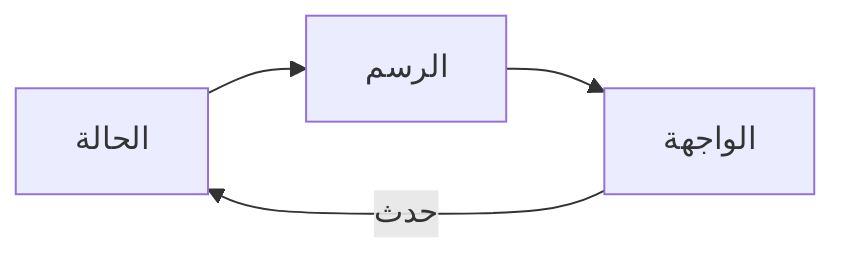

# ملاحظات عن React

React مكتبة لبناء واجهات المستخدم. كل جزء من الواجهة **مكوّن** (component) له حالته الخاصة.
لتثبيتها اكتب `npm install react` في الطرفية.

## الأفكار الأساسية

- المكوّنات دوال تُرجع واجهة.
- البيانات تنتقل من الأب إلى الابن عبر `props`.
- الحالة تتغير مع `useState`، فيُعاد رسم المكوّن.
  1. خطوة أولى متداخلة.
  2. خطوة ثانية متداخلة.

### المهام

- [x] قراءة الدليل الرسمي
- [ ] كتابة مكوّن صغير
- [ ] تجربة `useEffect` مع طلب شبكة

> [!tip] نصيحة
> اجعل كل مكوّن صغيرًا ويقوم بعمل واحد فقط.

> [!warning]- انتبه عند تغيير الحالة
> لا تغيّر الحالة مباشرة. استخدم دالة التحديث دائمًا.

> الكود يُقرأ أكثر مما يُكتب.

## مثال

```jsx
function Greeting({ name }) {
  return <h1>مرحبا، {name}!</h1>;
}
```

مساحة الدائرة هي $A = \pi r^2$، وهذه معادلة أطول:

$$
\sum_{i=1}^{n} i = \frac{n(n+1)}{2}
$$

## مقارنة

| الخطّاف | الاستخدام | منذ الإصدار |
| --- | --- | ---: |
| `useState` | حالة محلية | 16.8 |
| `useEffect` | آثار جانبية | 16.8 |
| `useId` | معرّفات فريدة | 18 |



## English section

This paragraph is in English, so it reads left to right even inside an Arabic note.
See [[Journal]] for the daily notes, or jump back to [the top](#ملاحظات-عن-react).

---

آخر تحديث: ٢٠٢٦/١١/١٩
